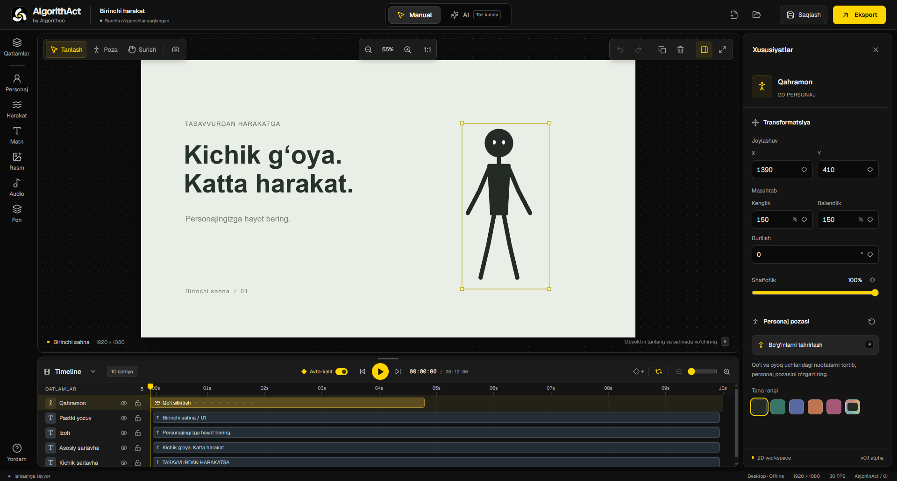

<p align="center"></p>

<h1 align="center">AlgorithAct</h1>

<p align="center"><strong>From imagination to motion.</strong><br />An offline desktop studio for original 2D character animation.</p>

<p align="center">
  <a href="LICENSE"></a>
  
  
  <a href="https://github.com/algorithco/AlgorithAct/actions/workflows/ci.yml"></a>
</p>

<p align="center">English · <a href="README.uz.md">O‘zbekcha</a><br /><a href="docs/GETTING_STARTED.md">Get started</a> · <a href="docs/USER_GUIDE.md">User guide</a> · <a href="CONTRIBUTING.md">Contribute</a> · <a href="docs/ROADMAP.md">Roadmap</a></p>



AlgorithAct brings characters, reusable motions, keyframes, text, images and audio into one local workspace. Animate a scene, save everything in a portable `.anim` project, and export a still frame or a video with sound. Editing runs locally and does not require an account or a cloud service.

**Version 0.1.0 is an early alpha.** The interface is currently in Uzbek. Windows x64 is the validated desktop target. **AI Build is a coming-soon screen; AI generation is not implemented.** See the [roadmap](docs/ROADMAP.md) for current limitations.

## What you can make

| Area | Available now |
| --- | --- |
| Characters | Original and Novcha rigs, vector artwork, palette changes and forward-kinematics pose handles |
| Motion | Idle, walk, wave, arm raise and bend; clip position, duration, speed, loop and blending |
| Animation | Keyframes, easing, auto-key, transforms, opacity, animated text properties and camera evaluation |
| Composition | Text, PNG/JPEG/WebP images, layers, pan/zoom, a resizable timeline and canvas focus mode |
| Audio | Waveforms, multiple clips, trimming, gain, mute, fades and offline stereo mixing |
| Projects | `.anim` ZIP files with embedded, hash-checked media; undo/redo, recovery and desktop backups |
| Export | PNG frames; desktop MP4/H.264/AAC and WebM/VP9/Opus, with progress and cancellation |

The same deterministic evaluator and PixiJS renderer drive preview and export. Video export uses a hidden Electron renderer and native FFmpeg. FFprobe checks frame count, dimensions, duration and audio before the destination is replaced.

## Run from source

Install **Node.js 24 LTS** and Git. Node.js 22.12+ on the 22.x line is also supported. Use the committed lockfile:

```sh
git clone https://github.com/algorithco/AlgorithAct.git
cd AlgorithAct
npm ci
npm run dev:desktop
```

For the browser development preview, run `npm run dev` and open `http://127.0.0.1:5173`. Browser mode supports editing and PNG export; MP4/WebM export requires the desktop app.

Editing and PNG export need no FFmpeg setup. To enable desktop video export or build the Windows package, prepare the pinned Windows x64 runtime once:

```sh
npm run prepare:ffmpeg -- --download
npm run dev:desktop
```

This explicitly downloads a checksum-verified archive from a pinned upstream GitHub release. For an offline build, use `npm run prepare:ffmpeg -- /path/to/the/pinned/archive.zip`. See the [FFmpeg runtime guide](resources/ffmpeg/README.md) for version, hashes, source links and overrides.

## Build the Windows app

On Windows x64, after preparing FFmpeg:

```sh
npm run package:win
npm start
```

Output: `release/AlgorithAct-win32-x64/AlgorithAct.exe`. Keep the entire application directory together. To create an NSIS installer:

```sh
npm run installer:win
```

Output: `release/installer/AlgorithAct-Setup-0.1.0-x64.exe`. Local builds are unsigned unless a maintainer configures signing. Source publication does not imply a downloadable binary release. Node.js is needed to build the app, not to run a packaged copy. See [building and releases](docs/BUILDING.md).

## Learn the workspace

1. Start in **Manual** mode with the sample scene.
2. Select a character and add a motion from **Harakat** (Motion).
3. Move the playhead, enable **Avto-kalit** (Auto-key), and change a pose or transform.
4. Add **Matn** (Text), **Rasm** (Image) or **Audio** from the left toolbar.
5. Choose **Saqlash** (Save) to keep a portable `.anim` project, then **Eksport** (Export).

| Shortcut | Action |
| --- | --- |
| `Space` | Play / pause |
| `V` / `P` / `H` | Select / pose / pan |
| `K` | Add a keyframe |
| `F` / `L` / `I` | Focus canvas / toggle layers / toggle inspector |
| `Shift+1` | Fit the scene |
| `Ctrl+S` / `Ctrl+O` | Save / open |
| `Ctrl+Z` / `Ctrl+Shift+Z` | Undo / redo |

The [user guide](docs/USER_GUIDE.md) covers audio, recovery, export and all shortcuts.

## Develop and verify

```sh
npm run check          # Types, ESLint, architecture rules, docs links, unit tests
npm run build          # Content, renderer, dependency notices, Electron main/preload
npm run test:e2e       # Workflows; native tests require the documented setup
```

Tests cover model/history properties, real desktop export, packaged apps and pixel references. A separate history check runs 10,000 sequences. Pixel references were recorded with Chrome/SwiftShader and Windows Arial and are checked on Windows. See [testing](docs/TESTING.md) for prerequisites and optional benchmarks.

The stack is **TypeScript · React · PixiJS · Electron · Web Audio · FFmpeg**. The animation engine has no UI, renderer or operating-system dependencies. [Architecture](docs/ARCHITECTURE.md) explains the boundaries; [project format](docs/PROJECT_FORMAT.md) documents `.anim` files.

## Documentation

| Start here | Go deeper |
| --- | --- |
| [Getting started](docs/GETTING_STARTED.md) | [Architecture](docs/ARCHITECTURE.md) |
| [User guide](docs/USER_GUIDE.md) | [Project format](docs/PROJECT_FORMAT.md) |
| [Development](docs/DEVELOPMENT.md) | [Testing](docs/TESTING.md) |
| [Troubleshooting](docs/TROUBLESHOOTING.md) | [Building and releases](docs/BUILDING.md) |
| [Roadmap](docs/ROADMAP.md) | [Design decisions and research](docs/README.md) |

## Contribute

Bug reports, focused fixes, documentation and animation improvements are welcome. Read [CONTRIBUTING.md](CONTRIBUTING.md), use a feature branch, and open a pull request against `main`. Discuss larger changes in an issue first. English and Uzbek are welcome.

Use [GitHub Issues](https://github.com/algorithco/AlgorithAct/issues) for bugs and proposals. Follow the [Code of Conduct](CODE_OF_CONDUCT.md); report vulnerabilities through [SECURITY.md](SECURITY.md).

## License and credits

AlgorithAct's original source and project materials use the [MIT License](LICENSE). Third-party components retain their licenses: Geist fonts use SIL OFL 1.1; the selected FFmpeg build uses LGPL-3.0-or-later; Electron/Chromium and JavaScript dependencies ship their notices. See [third-party notices](THIRD_PARTY_NOTICES.md).

Built by [Algorithco](https://github.com/algorithco) and contributors.
