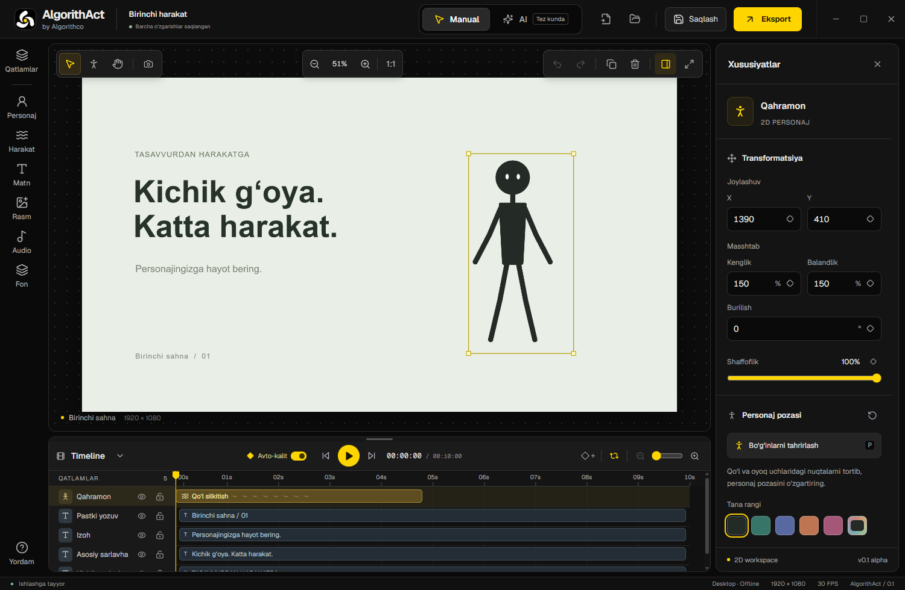

<p align="center"></p>

<h1 align="center">AlgorithAct</h1>

<p align="center"><strong>Tasavvurdan harakatga.</strong><br />Original 2D personajlar bilan oflayn animatsiya yaratish uchun desktop studiya.</p>

<p align="center"><a href="README.md">English</a> · O‘zbekcha · <a href="LICENSE">MIT</a> · v0.1.0 alpha</p>



AlgorithAct personaj, tayyor harakat, keyframe, matn, rasm va audioni bitta lokal ish maydonida birlashtiradi. Loyihani aktivlari bilan `.anim` faylida saqlash, PNG kadr yoki ovozli video eksport qilish mumkin. Tahrirlash uchun akkaunt va bulut xizmati talab qilinmaydi.

**Loyiha hali alpha bosqichida.** Interfeys o‘zbekcha. Desktop paketlari Windows x64, macOS Intel/Apple Silicon va Linux x64/ARM64 uchun yaratiladi. **AI Build hozircha “Tez kunda” sahifasi; AI generatsiyasi mavjud emas.** Qolgan ishlar [yo‘l xaritasida](docs/ROADMAP.md).

## Yuklab olish

[0.1.0 relizi](https://github.com/algorithco/AlgorithAct/releases/tag/v0.1.0) sahifasida Windows installer, macOS DMG/ZIP va Linux AppImage/tar paketlari bor. Qurilmangiz protsessoriga mos x64 yoki arm64 variantini tanlang. FFmpeg/FFprobe paket ichida; Node.js o‘rnatish shart emas. Bu dastlabki alpha, installerlar publisher sertifikatisiz tarqatiladi. [Reliz tafsilotlari](docs/releases/0.1.0.md).

Native kompilyator vositalari o‘rnatilgan Windows x64, macOS va Linux tizimlarida paket yaratish:

```sh
npm run build:ffmpeg
npm run installer:desktop
npm start
```

[FFmpeg build talablari](resources/ffmpeg/README.md) va [reliz qo‘llanmasi](docs/BUILDING.md) bilan tanishing.

## Imkoniyatlar

- Original va Novcha: ikki xil proporsiyali rig, vector skin, ranglar va bo‘g‘in pozasini tahrirlash.
- Tinch turish, yurish, qo‘l silkitish, qo‘l ko‘tarish va ta’zim; klip tezligi, davomiyligi, loop va blend.
- Keyframe, easing, avto-kalit, transform, shaffoflik va animatsiyali matn xususiyatlari.
- Matn, PNG/JPG/WebP importi, qatlamlar, pan/zoom, tortiladigan timeline va fokus rejimi.
- Audio, waveform, trim, gain, mute, fade va bir nechta klipni miks qilish.
- Undo/redo, `.anim` ZIP, SHA-256 tekshiruvi, avtosaqlash va desktop `.bak` nusxasi.
- PNG; desktopda MP4/H.264/AAC va WebM/VP9/Opus, progress, cancel va FFprobe tekshiruvi.

## Ishga tushirish

**Node.js 24 LTS** va Git o‘rnating. Node.js 22.x qatorida 22.12 yoki yangiroq versiya ham qo‘llanadi.

```sh
git clone https://github.com/algorithco/AlgorithAct.git
cd AlgorithAct
npm ci
npm run dev:desktop
```

Brauzerdagi ishlab chiqish ko‘rinishi: `npm run dev`, so‘ng `http://127.0.0.1:5173`. Bu rejimda tahrirlash, `.anim` saqlash/ochish va PNG mavjud; video eksporti desktop ilovasida ishlaydi.

Windows x64 video eksporti va paket yaratishdan oldin FFmpegni bir marta tayyorlang:

```sh
npm run prepare:ffmpeg -- --download
```

Buyruq aniq upstream release’dan arxiv yuklaydi va checksumni tekshiradi. Oflayn yo‘l: `npm run prepare:ffmpeg -- /path/to/the/pinned/archive.zip`. [FFmpeg qo‘llanmasi](resources/ffmpeg/README.md).

## Windows paketi va installer

Windows x64’da, FFmpeg tayyorlangach:

```sh
npm run package:win
npm start
```

Natija: `release/AlgorithAct-win32-x64/AlgorithAct.exe`. Papkadagi barcha yon fayllarni birga saqlang. Paketda FFmpeg/FFprobe bor; yakuniy foydalanuvchiga Node.js yoki PATH sozlash kerak emas.

```sh
npm run installer:win
```

Installer: `release/installer/AlgorithAct-Setup-0.1.0-x64.exe`. Mahalliy build signing sozlanmaguncha imzolanmagan. Source kodning e’lon qilinishi tayyor binary release borligini anglatmaydi. [Build va release tartibi](docs/BUILDING.md).

## Birinchi animatsiya

1. **Manual** rejimida namuna sahnani oching.
2. Personajni tanlab, **Harakat** kutubxonasidan motion qo‘shing.
3. Playhead vaqtini suring, **Avto-kalit**ni yoqing va poza yoki transformni o‘zgartiring.
4. **Matn**, **Rasm** yoki **Audio** qo‘shing.
5. **Saqlash** orqali `.anim` nusxa yarating, keyin **Eksport**ni tanlang.

| Tugma | Vazifa |
| --- | --- |
| `Space` | Ijro / pauza |
| `V`, `P`, `H` | Tanlash, poza, surish |
| `K` | Kalit qo‘shish |
| `F`, `L`, `I` | Fokus, qatlamlar, xususiyatlar |
| `Shift+1` | Sahnani sig‘dirish |
| `Ctrl+S`, `Ctrl+O` | Saqlash, ochish |
| `Ctrl+Z`, `Ctrl+Shift+Z` | Undo, redo |

To‘liq yo‘riqnoma: [User guide](docs/USER_GUIDE.md). Texnik hujjatlar inglizcha; avvalgi tadqiqot va dizayn qaydlari o‘zbekcha saqlangan.

## Tekshirish va hissa qo‘shish

```sh
npm run check
npm run build
npm run test:e2e
```

Native va packaged eksport testlari, Windows golden kadrlar va history sinovi uchun [test qo‘llanmasini](docs/TESTING.md) o‘qing. [Arxitektura](docs/ARCHITECTURE.md), [loyiha formati](docs/PROJECT_FORMAT.md) va [hujjatlar indeksi](docs/README.md) dasturchilar uchun boshlang‘ich nuqtalardir.

O‘zgarishlarni alohida branch’da qiling va `main`ga PR oching. Inglizcha va o‘zbekcha issue/PR qabul qilinadi. [Hissa qo‘shish tartibi](CONTRIBUTING.md), [hamjamiyat qoidalari](CODE_OF_CONDUCT.md) va [xavfsizlik siyosati](SECURITY.md).

## Litsenziya

AlgorithAct’ning original kodi va loyiha materiallari [MIT](LICENSE) ostida. FFmpeg, shrift va boshqa dependency’lar o‘z litsenziyalarida qoladi. [Uchinchi tomon notice’lari](THIRD_PARTY_NOTICES.md).

[Algorithco](https://github.com/algorithco) va hissa qo‘shuvchilar tomonidan yaratilgan.
