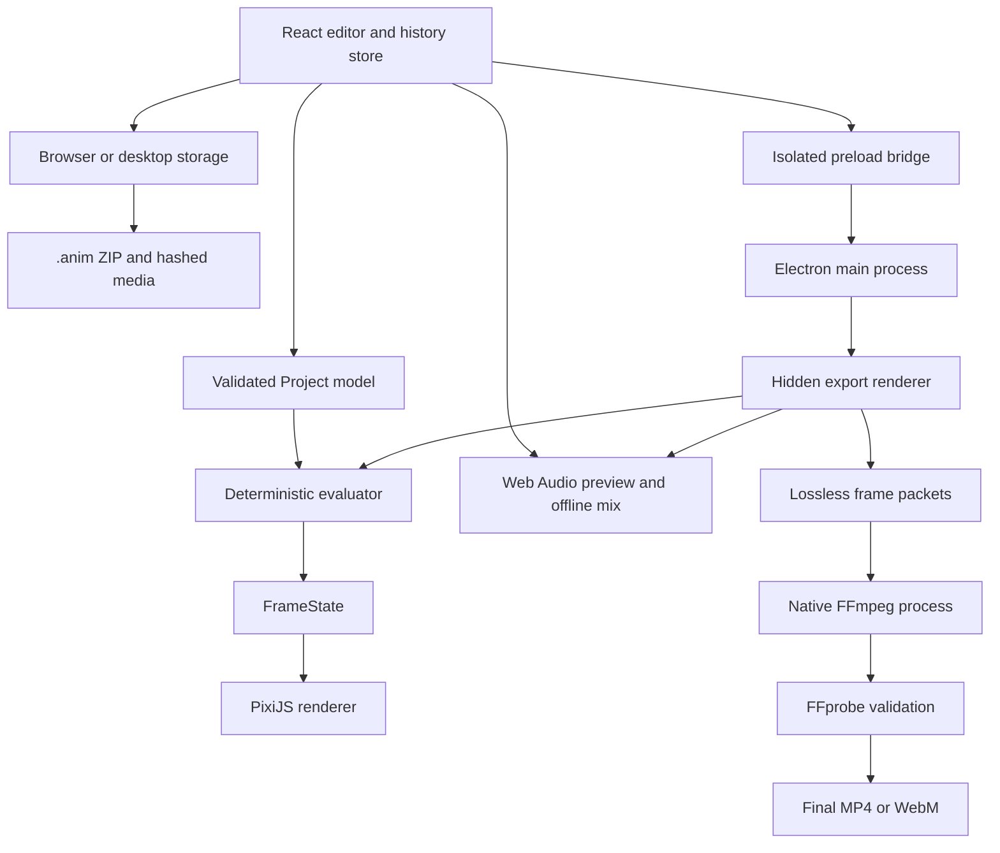

# Architecture

AlgorithAct separates editable data, deterministic animation evaluation and environment-dependent services. Shared interfaces are defined in `src/contracts/`; Zod types and semantic validation live in `src/model/`.

## Data and evaluation

`Project` stores scenes, assets and libraries of rigs, skins, characters and motions. Parsing checks schema constraints and semantic references before data enters the editor. A `.anim` project embeds referenced media rather than depending on paths outside the file. See [project format](PROJECT_FORMAT.md).

The engine takes a project, scene ID and time and returns a `FrameState`. It samples reusable motion clips, blends them, applies scene property tracks, resolves forward kinematics and the camera, and emits draw nodes. Explicit scene keys take precedence over the motion result. Evaluation does not mutate the source project.

The engine must not depend on clocks, randomness, DOM, React, PixiJS, Electron or Node services. ESLint and dependency-cruiser enforce boundaries and cycles. This makes seeking, reverse seeking and export use the same data evaluation path.

## Editor and history

`ProjectStore` uses Immer patches for reversible transactions, drag coalescing and saved-position tracking. UI state such as panels, selection and viewport is kept separate from serialized project data. The current editor operates on `sceneOrder[0]`; a multi-scene data structure does not mean multi-scene editing UI is complete.

Built-in content is authored in `content/characters/hero/build.ts` and generated into `public/content/`. Shared rig profiles let motions target characters with different segment proportions. Renderer artwork is not copied from research references.

## Rendering and audio

The PixiJS renderer consumes draw nodes and assets. Preview and export have distinct renderer instances, with a retained export capture target. Raw RGBA and PNG capture share the rendering result.

Web Audio decodes supported imports into a bounded cache, schedules clips for preview and uses the output audio clock when audio is present. Offline export follows the same clip scheduling and gain/fade rules to produce 48 kHz, stereo PCM16 WAV. See [audio decision](decisions/0002-audio-preview-export.md).

## Storage and recovery

`ProjectStorage` has browser and desktop implementations. Both use the versioned ZIP container for explicit project files. Browser saves download a `.anim`; browser recovery uses IndexedDB. Desktop operations pass bytes through the preload, with size checks and native dialogs. Desktop writes use a temporary file, flush and rename; an explicit save preserves a `.bak` copy.

Autosave is debounced in the editor, with a maximum pending delay. Existing recovery data remains in the legacy `algorithco-animation` application-data folder. Failure-injection and long-run recovery validation remain open work.

## Desktop and export boundary

Electron windows use sandboxing, context isolation and disabled Node integration. The preload exposes a typed API rather than arbitrary IPC. Main-process handlers validate the calling window, schema, selected scene, preset, media sizes and video dimensions. New windows, navigations and permission requests are denied.

Export runs in a hidden renderer so the main editor stays available. Frames travel through a MessagePort as bounded lossless packets; backpressure prevents an unbounded frame queue. This transport does not claim zero-copy ArrayBuffer transfer. See [frame transport](decisions/0001-frame-transport.md) and [capture decisions](decisions/0003-export-capture-and-transport.md).

FFmpeg writes a temporary video, audio is muxed if present, and FFprobe validates output before rename. Failure or cancellation cleans temporary output while preserving the preceding destination. A single export job is active at a time.

FFmpeg resolution follows explicit environment overrides, packaged resources, checkout resources, then PATH. Windows packaging verifies pinned hashes and ships executables/DLLs outside `app.asar`. Full licenses are retained; see [third-party notices](../THIRD_PARTY_NOTICES.md).
