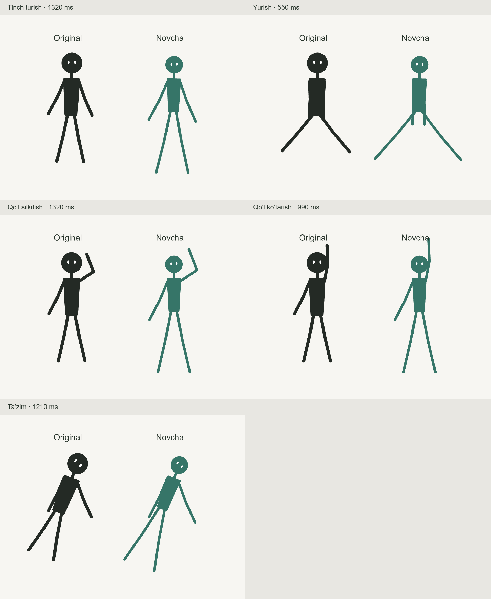

# Ikki proporsiyali humanoid: R4 tekshiruvi

Manba: System Design §8 R4, §9 Core/V1. Ikkala character ham `humanoid` profilidagi bir xil 10 bone key va topologiyadan foydalanadi. Motion qiymatlari rest’ga nisbatan delta rotation; character uchun alohida motion yoki renderer shoxi qo‘shilmadi.

| O‘lcham | Original | Novcha |
| --- | ---: | ---: |
| Torso | 125 | 112 |
| Yuqori qo‘l / bilak | 62 / 66 | 72 / 80 |
| Son / boldir | 82 / 88 | 108 / 116 |
| Bosh radiusi | 37 | 31 |
| Yelka oralig‘i | 52 | 44 |
| Qo‘l-oyoq chizig‘i | 11 | 9 |

Novcha — rang yoki umumiy scale varianti emas. Alohida rig va vector skin, skin segmentlari o‘z rig uzunligiga mos. Default sahnadagi Original va eski `.anim` loyihalarining ichki nusxalari o‘zgarmaydi. Yangi loyihalarning kutubxonasi ikkala rig’ni saqlaydi. Kutubxona thumbnail’i ham rig/skin’dan chiziladi.

Tekshiruvlar:

- Idle, walk, wave, raise va bend — har biri 0/25/50/75% va oxirgi millisekundda, keyin teskari tartibda seek qilindi. Pose qiymati va rotation o‘qlari ikkala rig’da bir xil; child joint parent rest nuqtasiga ulangan, barcha matritsalar finite, model mutatsiyasi yo‘q.
- Besh motion’ning har biri ikkala character bilan Pixi preview va eksport target’ida chizildi. Shu sinovdagi RGBA hash’lari o‘zaro aynan teng.
- UI’da Novcha qo‘shish, motion biriktirish, pose handle va `.anim` ichida ikki xil rig saqlanishi tekshirildi.
- Quyidagi contact sheet’da bo‘g‘inlarning ochilib qolishi, segment uzunligi, bosh/qo‘l-oyoq kesilishi va siluet ko‘rib chiqildi. Asosiy ulanishlar yopiq, Novcha proporsiyasi aniq farq qiladi.

Chegara: yurish joyida bajariladi, foot-lock yoki yurish yo‘li yo‘q; ta’zim ushbu sodda planar rig’da torso egilishi sifatida ifodalanadi. Bu texnik va agent vizual QA natijasi. R3 dagi dizaynerning “V1 sifati” tasdig‘i va to‘liq motion-cycle badiiy bahosi hali olinmagan.

Manba: `content/characters/hero/build.ts`. Qayta tekshirish: `npm run check`, `npm run build`, `npm run test:e2e`. E2E rasmlari va namunaviy loyiha `.qa/retarget/` ichida yangilanadi.
