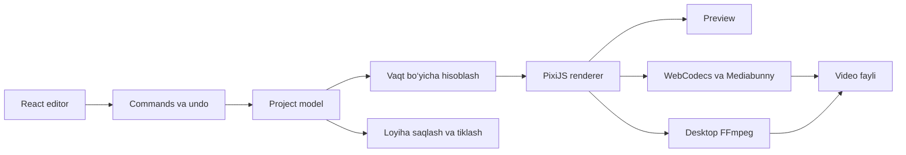

# Personajli video editori: texnologiyalar tadqiqoti va qurish rejasi

Tadqiqot sanasi: 2026-10-25, Asia/Tashkent.

Holat: texnik tavsiya. Ilova kodi yozilmadi, reference repository clone qilinmadi, kutubxonalar o‘rnatilmadi. Reference’ning ochiq README, arxitektura hujjati va package.json fayli masofadan o‘rganildi. Quyidagi unumdorlik mezonlari hali o‘lchanmagan; ular prototipda tekshiriladigan talablar.

## 1. Ishchi yo‘nalish

Tavsiya: noldan quriladigan **2D personajli video editori**. Birinchi personaj — tanasi, yuzi va alohida qo‘l-oyoqlari bor o‘zimizning original personajimiz. Birinchi texnik prototip brauzerda ishlaydi; shu yadro keyin Windows desktop ilovasida ham ishlatiladi.

Foydalanuvchi yo‘nalishi: hozir o‘zimizning yassi 2D personajlarimizni yaratamiz, keyinchalik shu dizaynlarning 3D variantlaridan ham foydalanish imkonini saqlaymiz. Yakuniy video uslubi, platforma va auditoriya hali belgilanmagan. Hozirgi MVP 2D; keyingi 3D model va rig alohida ishlab chiqarish bosqichida tayyorlanadi. Personaj ID, harakat nomlari va timeline modeli rendererdan ajratiladi.

Taklif qilinayotgan foydalanuvchi jarayoni:

1. Personaj va fonni tanlash.
2. Yurish, qo‘l silkitish yoki ko‘rsatish kabi tayyor harakatni qo‘shish.
3. Pozani, matnni, audio va kamera harakatini timeline’da sozlash.
4. Natijani ko‘rib, loyiha faylini saqlash va video eksport qilish.

Mahsulotning boshlang‘ich ustunligi sifatida tez sahna yig‘ish, takror ishlatiladigan harakatlar va sodda boshqaruvni tavsiya qilaman. Bu mahsulot qarori; reference’da bu imkoniyatlar yo‘q degan da’vo emas.

## 2. Reference’dan aniqlanganlar

StykAnimate’da personaj bo‘g‘inlari va IK, ikki xil timeline, keyframe/easing, kamera, effektlar, audio hamda ko‘p formatli eksport mavjud. Desktop qismi Electron; arxitektura hujjatida custom WebGPU renderer, worker’lar, Python orqali fayl kodeklari, desktop FFmpeg va brauzer WebCodecs eksporti tasvirlangan. [README](https://github.com/filippocalippo/StykAnimate-App), [arxitektura](https://github.com/filippocalippo/StykAnimate-App/blob/main/docs/ARCHITECTURE.md), [package.json](https://github.com/filippocalippo/StykAnimate-App/blob/main/package.json).

Biz uchun foydali arxitektura g‘oyasi — loyiha ma’lumoti, tahrirlash buyruqlari, vaqt bo‘yicha animatsiya hisoblash va tasvir chizishni ajratish. Reference’dagi Pivot/Stick Nodes importi va maxsus format mosligi bizning birinchi versiyamizga talab qilinmaydi; shu sabab uning Python kodek qatlami va custom GPU implementatsiyasini takrorlashga ehtiyoj ko‘rinmayapti.

Bu tadqiqot reference ilovaning ishlashini sinagan audit emas. Muayyan xato yoki ishlash tezligi haqida xulosa chiqarilmadi.

## 3. Tavsiya etiladigan texnologiyalar

| Qatlam | Tanlov | Vazifa va sabab |
| --- | --- | --- |
| Editor interfeysi | React + TypeScript + Vite | Panel, menyu, inspector, timeline va tiplangan dastur tuzilmasi. Vite SPA uchun yetarli boshlang‘ich vosita. |
| 2D sahna | PixiJS, boshlanishida WebGL | Personaj qismlari, rasmlar, matn va kamerani bitta sahna daraxtida chizish. WebGPU keyingi o‘lchovlarga qarab yoqiladi. |
| Tahrirlash holati | Zustand | Tanlangan obyekt, faol vosita va panel holati. Loyiha o‘zgarishlari alohida command/undo tizimidan o‘tadi. |
| Animatsiya yadrosi | O‘zimizning TypeScript moduli | Keyframe, easing, clip va rig. Istalgan vaqt uchun sahnani bir xil usulda hisoblash. |
| Fon vazifalari | Web Workers; muhit qo‘llasa OffscreenCanvas | Og‘ir hisoblash va media vazifalarini UI’dan ajratish. Main thread va worker orasida cheklangan navbat ishlatiladi. |
| Personaj aktivlari | Qismlarga ajratilgan SVG/PNG + rig JSON | Bosh, tana va a’zolar alohida; ularning tayanch nuqtalari va bog‘lanishlari ma’lumot sifatida saqlanadi. |
| Audio | Web Audio API + OfflineAudioContext | Preview ijrosi, ovoz balandligi va video uchun oldindan audio miks tayyorlash. |
| Brauzer eksporti | WebCodecs + Mediabunny | Kadrlarni kodlash, audio bilan birlashtirish va MP4/WebM faylini yig‘ish. |
| Desktop | Electron | Chromium/Node muhitida editor, mahalliy fayllar va native encoder jarayoni. |
| Desktop eksporti | Alohida native FFmpeg jarayoni | Brauzer encoderi yetarli bo‘lmaganda video/audio eksporti; kerakli build va kodeklar alohida tekshiriladi. |
| Saqlash | IndexedDB + Dexie; tashqi loyiha fayli | Avtosaqlash va tiklash. Ko‘chirish uchun versiyalangan JSON manifest va aktivlardan iborat ZIP konteyner. |
| Tekshirish | Vitest + Playwright | Vaqt/rig/undo hisoblari va editorning asosiy ish jarayoni. |
| Aktiv tayyorlash | Inkscape yoki mavjud vektor dizayn vositasi | Alohida tana qismlari, ko‘z-og‘iz variantlari va eksportga mos aktivlar. |

PixiJS’ning amaldagi 8.x hujjatida WebGL ishlab chiqarish uchun tavsiya etilgan, WebGPU esa experimental deb berilgan. Shuning uchun WebGPU’ni birinchi versiya talabi qilishni tavsiya qilmayman. [PixiJS renderer hujjati](https://pixijs.com/8.x/guides/components/renderers).

Vite, Zustand va Dexie tanlovlari bo‘yicha rasmiy manbalar: [Vite](https://vite.dev/guide/), [Zustand](https://zustand.docs.pmnd.rs/learn/getting-started/introduction), [Dexie](https://dexie.org/docs/Tutorial/Getting-started). Audio miksning asosiy vositasi: [OfflineAudioContext](https://developer.mozilla.org/en-US/docs/Web/API/OfflineAudioContext).

React panel holatini boshqaradi. Har kadrda butun sahnani React orqali qayta render qilish o‘rniga, animatsiya yadrosi Pixi obyektlariga hisoblangan qiymatlarni beradi. Bu arxitektura tavsiyasi; uning foydasi prototipda o‘lchanadi.

## 4. Muhim muqobillar

| Variant | Qachon mos | Hozirgi qaror |
| --- | --- | --- |
| Konva | Asosan rasm, matn, shakl va drag/resize funksiyali yengil editor | Muqobil. Personajlar va ko‘p harakatli sahna asosiy bo‘lgani uchun PixiJS bilan boshlash tavsiya qilinadi. Tezlik farqi hali benchmark qilinmagan. |
| PixiJS | Ko‘p qismlardan tuzilgan 2D sahna, personaj va effektlar | Tavsiya. Selection, transform handle va timeline’ni baribir o‘zimiz quramiz. |
| Three.js + Blender + glTF | Haqiqiy 3D, kamera burchaklari, skeletal animation | 3D mahsulot yo‘li uchun. Birinchi 2D MVP bilan bir vaqtda qo‘shilmaydi. |
| Rive | Oldindan tayyorlangan rig va animatsiyalarni runtime’da ijro etish | Tayyor personaj kliplari uchun alohida nomzod. Bizning timeline, erkin tahrirlash va aniq vaqtga seek/eksport talablariga mosligi kichik sinovda tekshiriladi. |
| Spine | Professional 2D rig va animator ish jarayoni | Kuchli muqobil, lekin pulli Editor va runtime litsenziya shartlari bor. Hozirgi minimal rig talabiga standart dependency sifatida kiritilmaydi. |
| Remotion | React asosidagi video shablonlari va dasturiy kompozitsiya | Keyinchalik templating uchun foydali bo‘lishi mumkin. Bizga zarur personaj rig editori va timeline’ni alohida hal qilish kerak. Litsenziyasi tashkilot hajmi va foydalanishga bog‘liq. |
| Tauri | Kichikroq desktop paketiga ustuvorlik berilganda | Muqobil. OS webview’lari farqi sabab media va GPU imkoniyatlarini har platformada tekshirish zarur. |

Konva ham ishlaydigan tanlov: rasmiy hujjat katta sahnalarda hisoblash, chizish va layer xotirasini boshqarish kerakligini ko‘rsatadi. PixiJS avtomatik ravishda har qanday sahnada tezroq degan xulosa chiqarilmadi. [Konva performance](https://konvajs.org/docs/performance/All_Performance_Tips.html).

Rive runtime’lari MIT litsenziyali. Spine’da esa runtime integratsiyasi Editor litsenziyasiga bog‘langan. Bu ikki yechimning biznes shartlarini bir xil deb olish kerak emas. [Rive](https://rive.app/), [Spine runtime litsenziyasi](https://esotericsoftware.com/spine-runtimes-license), [Spine Editor litsenziyasi](https://esotericsoftware.com/spine-editor-license).

Remotion’da tashkilot hajmi va foydalanish turiga qarab bepul yoki Company rejimi bor; uni oddiy MIT kutubxonasi sifatida rejalashtirmaymiz. [Remotion litsenziya va narx modeli](https://www.remotion.dev/docs/license/pricing).

Electron Chromium va Node.js’ni o‘zi bilan olib keladi. Tauri tizim webview’idan foydalanadi. Media imkoniyatlarini boshqarish uchun Electron, paket hajmi ustuvor bo‘lsa Tauri nomzod bo‘ladi. Bu mahsulot ehtiyojlaridan chiqarilgan tanlov. [Electron](https://www.electronjs.org/docs/latest/), [Tauri process model](https://v2.tauri.app/concept/process-model/).

## 5. Personaj tanlash va tayyorlash

Foydalanuvchining so‘nggi ko‘rsatmasi bo‘yicha sodda tayoqchali figuraga qalinroq tana, bosh va ikkita ko‘z qo‘shilgan SVG sinovi yaratildi. Bu yakuniy tanlov emas. Yosh toifasi mezon emas; detalli multfilm ko‘rinishi rad etilgan. Quyidagi tasma, kapsula, burchakli shakllar va kontur izlanishlari tarix sifatida saqlangan. Amaldagi rasm va tafsilotlar: [original personaj briefi](./original-character-direction-2026-10-25.md).

| Nomzod | Vizual yo‘nalish | Taklif etilgan foydalanish |
| --- | --- | --- |
| 1 — tasma | Keng va oqimli shakllar | O‘ziga xos siluet va egilish usulini tekshirish uchun. |
| 2 — kapsula | Sodda oblong a’zolar va to‘liq tana | Cutout rig va tez pose qilish prototipi uchun nomzod. |
| 3 — burchakli shakllar | Geometrik tana va a’zolar | Burchakli vizual tilni tekshirish uchun. |
| 4 — kontur | Oq ichki maydon va aniq tashqi chiziq | Kam detalli chizilgan personaj yo‘nalishi uchun. |

Bu variantlar tayyor animatsion aktiv emas, yo‘nalish tanlash uchun konseptlar. Yakuniy chiziq, qismlar, pivot, rig va harakatlar alohida tayyorlanadi.

Vizual tanlov hali foydalanuvchi tomonidan tasdiqlanmagan. Dastlabki ishlab chiqarish bahosiga ko‘ra kapsulali variant sodda rig sinovi uchun qulay nomzod. Texnik sinovda ham o‘zimiz yaratgan qismlardan foydalaniladi. Personaj rigini dastur kodiga qattiq bog‘lamasak, keyin boshqa tashqi ko‘rinishga almashtirish osonlashadi.

Original personaj uchun birinchi texnik topshiriq:

- Dastlab bitta old yoki 3/4 ko‘rinish; keyin yon va boshqa ko‘rinishlar alohida aktivlar bilan.
- Taxminan 12–16 mustaqil tana qismi: tana, bosh, yelka/bilak, kaft, son/boldir va oyoq panjasi.
- Ko‘zning ochiq/yumilgan, og‘izning bir nechta gapirish va hissiyot variantlari.
- Har bir qism uchun pivot, parent, local transform va chizilish tartibi.
- Umumiy skeletga mos kiyim/rang variantlari.
- Birinchi harakatlar: idle, blink, walk, wave, point va talk.
- Oddiy FK va qo‘l-oyoq uchun ikki segmentli IK; keyin foot lock va murakkab constraint’lar.

Bitta butun PNG personajning qo‘l-oyog‘ini mustaqil harakatlantirishga yetmaydi. Qismlar, pivotlar va rig alohida tayyorlanishi kerak. SVG manba aktiv bo‘lishi mumkin; Pixi pipeline’ida u qanday teksturaga aylanishi va 1080p’da sifati prototipda tekshiriladi.

3D zarur bo‘lsa, tekshirilgan muqobil — Quaternius Universal Base Characters: CC0, humanoid rig, glTF/FBX. Bepul va Source paketlarining tarkibi bir xil emas; tanlangan yuklamaning tarkibini ko‘rish kerak. [Quaternius](https://quaternius.com/packs/universalbasecharacters.html), [Three.js GLTFLoader](https://threejs.org/docs/pages/GLTFLoader.html).

## 6. O‘zimiz quradigan yadro

Tayyor kutubxonalar UI, chizish va kodlashni yengillashtiradi. Mahsulotning quyidagi qismlari o‘zimizniki bo‘ladi:

1. **Loyiha modeli:** scene, layer, asset, personaj definition/instance, rig, motion clip, keyframe, audio, kamera va format versiyasi.
2. **Tahrirlash buyruqlari:** obyekt qo‘shish/o‘chirish, ko‘chirish, keyframe va rig tahriri; undo/redo uchun o‘zgarishlar tarixini saqlash.
3. **Animatsiya hisoblash:** `evaluateAt(project, time)` g‘oyasi. Sahna istalgan vaqtda to‘g‘ridan-to‘g‘ri hisoblanadi; boshidan qayta ijro etish talab qilinmaydi.
4. **Rig tizimi:** ota-bola transformlari, bo‘g‘in chegaralari, FK/IK, expression va skin almashtirish.
5. **Motion library:** clip davomiyligi, loop, tezlik, boshlanish vaqti, kerak bo‘lsa root motion va keyframe bilan ustidan tuzatish qoidalari.
6. **Editor vositalari:** selection, sahna zoom/pan, transform handle, pose handle, snapping va kamera ramkasi.
7. **Timeline:** track, clip, keyframe, scrub, easing, audio joylashuvi va zarurat bo‘lganda ko‘rinadigan qatorlarni chizish.
8. **Fayl va tiklash:** validatsiya, format migratsiyasi, aktivlar, avtosaqlash va eksportdan mustaqil loyiha saqlash.

Ishchi arxitektura:

Preview va eksport bitta vaqt hisoblash va sahna chizish qoidalaridan foydalanadi. Playback vaqtida audio mavjud bo‘lsa audio soati asos bo‘ladi; eksportda vaqt kadr raqamidan olinadi. Tasodifiy effektlar qo‘shilsa seed saqlanadi. Kadrlar qo‘shilib boradigan o‘zgaruvchan fizik simulyatsiya birinchi bosqichda kiritilmaydi.

Keyingi papka tuzilmasi uchun taklif: `editor`, `core`, `renderer`, `media`, `storage`, `desktop` va `assets`. Buning uchun hozirdan murakkab monorepo infratuzilmasi talab qilinmaydi.

## 7. Video eksporti: eng erta tekshiriladigan xavf

WebCodecs kadr/audio kodlashni beradi, lekin o‘zi tayyor MP4 faylini yig‘maydi. Mediabunny konteynerga yozish va track’larni birlashtirishga xizmat qiladi. Kodeklarning ishlashi brauzer va qurilmaga bog‘liq; H.264 borligi AAC ham mavjud degani emas. [WebCodecs](https://developer.mozilla.org/en-US/docs/Web/API/WebCodecs_API), [Mediabunny kodek qo‘llashi](https://mediabunny.dev/guide/supported-formats-and-codecs).

Eksport siyosati:

- Asosiy mahsulot formati: MP4, H.264 video + AAC audio; tanlangan muhitda ikkalasi alohida sinovdan o‘tkaziladi.
- Brauzerda to‘liq konfiguratsiya — o‘lcham, FPS, bitrate, audio sample rate va kanal soni — eksportdan oldin tekshiriladi.
- MP4 konfiguratsiyasi yo‘q bo‘lsa, mavjud WebM video/audio kombinatsiyasi tekshiriladi. WebM ham barcha muhitda kafolatlanmaydi.
- Web eksport imkoniyati yetarli bo‘lmagan muhitda desktop eksport yoki keyingi server eksporti yo‘li kerak bo‘ladi.
- Shaffof video keyingi bosqich: PNG sequence orqali avval tekshirish, keyin kerakli WebM alpha pipeline’ini alohida sinash. MP4/H.264 uchun alpha va’da qilinmaydi.
- Kadr vaqti `frameIndex / fps`; eksport preview ekranini real vaqtda yozib olishga bog‘lanmaydi.
- Kadrlar cheklangan navbatda qayta ishlanadi; encoder band bo‘lsa producer kutadi. Barcha kadrlar RAM’da to‘planmaydi.
- Katta chiqish fayli imkon qadar diskka oqim bilan yoziladi. Mediabunny `StreamTarget` byte offset va backpressure qoidalariga rioya qilishni talab qiladi.
- Export job’ida progress, cancel, vaqtinchalik fayl va tugallanmagan natijani tiklash/tozalash qoidalari bo‘ladi.

Rasmiy hujjatlar: [VideoEncoder konfiguratsiyasini tekshirish](https://developer.mozilla.org/en-US/docs/Web/API/VideoEncoder/isConfigSupported_static), [Mediabunny yozish va streaming](https://mediabunny.dev/guide/writing-media-files).

ffmpeg.wasm’ni asosiy eksport dvigateli qilish tavsiya etilmaydi: o‘z FAQ’ida native FFmpeg’dan sekinligi va multithread variantining CPU/RAM sarfi kattaroqligi qayd etilgan. U kichik format konvertatsiyasi uchun keyinchalik baholanishi mumkin. [ffmpeg.wasm FAQ](https://github.com/ffmpegwasm/ffmpeg.wasm/blob/main/apps/website/docs/faq.md).

Texnik xotira sababi: bitta 1920×1080 RGBA kadr 8,294,400 bayt. 60 soniya × 30 FPS = 1,800 kadr; hammasini xom holda tutish taxminan 14.9 GB talab qiladi. Bu o‘lchangan ilova RAM’i emas, kadr hajmidan hisoblangan misol.

Saqlashda browser avtosaqlashi bilan tashqi loyiha fayli ikkisi ham zarur: browser storage kvotasi va eviction holatlari mavjud. [MDN storage qoidalari](https://developer.mozilla.org/en-US/docs/Web/API/Storage_API/Storage_quotas_and_eviction_criteria).

## 8. Qurish bosqichlari va tayyorlik mezonlari

### 0-bosqich — texnik prototip

Ishlar: bitta oddiy rig, ikki harakat, matn/fon, audio va bir xil evaluator’dan preview hamda eksport. Brauzer va Electron/native encoder yo‘llarini kichik alohida sinovlarda baholash.

Tayyorlik mezoni: 1080p, 30 FPS, 60 soniyalik test video; 16:9 va 9:16; audio bilan aniq davomiylik. Fontlar, alpha kompozitsiyasi va rang farqlari tekshiriladi. Aynan shu sinovdan keyin asosiy texnologiyalar yakunlanadi.

### 1-bosqich — editor poydevori

Ishlar: loyiha modeli, canvas pan/zoom, obyekt tanlash va ko‘chirish, layer, matn/rasm qo‘shish, command tarixi, save/load.

Tayyorlik mezoni: loyiha yopilib ochilganda sahna va aktivlar qaytadi; asosiy tahrirlar undo/redo’da to‘g‘ri ishlaydi.

### 2-bosqich — personaj va animatsiya

Ishlar: original personaj rig’i, pose handle, oddiy IK, keyframe/easing va boshlang‘ich harakatlar kutubxonasi. Clip bilan qo‘lda qo‘yilgan keyframe ustuvorligi aniq belgilanadi.

Tayyorlik mezoni: walk, wave, point va talk birinchi personajda ishlaydi; timeline’da oldinga-orqaga sakraganda natija bir xil.

### 3-bosqich — to‘liq video yig‘ish

Ishlar: ketma-ket sahnalar, kamera transformi, voice/music treklari, ovoz balandligi, oddiy cut/fade va matn.

Tayyorlik mezoni: foydalanuvchi 30–60 soniyalik demo videoni editor ichida yig‘ib, audio bilan ko‘ra oladi.

### 4-bosqich — eksport va barqarorlik

Ishlar: eksport navbati, capability probing, native encoder, cancel/progress, avtosaqlash/tiklash va Windows paketlash.

Tayyorlik mezoni: chiqarilgan video tashqi player’da ijro etiladi, davomiylik va kadr soni to‘g‘ri; bekor qilish editorni ishlashda qoldiradi; qayta ochishda loyiha tiklanadi.

Vaqt bahosi jamoa tarkibi, original personaj tayyorlash hajmi va 0-bosqichdagi natijalardan keyin beriladi. Ushbu bosqichlar ish ketma-ketligi, kalendar va’dasi emas.

## 9. Benchmark va qabul rejasi

Bu tekshiruvlar hali bajarilmagan.

- Muhitlar: boshlang‘ich Windows kompyuter, Chrome/Edge va paketlangan Electron. CPU, GPU, RAM, OS va runtime versiyasi yozib olinadi.
- Oddiy sahna: 1 personaj, fon, matn va audio. Yuklama sahnasi: 5 personaj, 50 oddiy obyekt va bir nechta audio clip.
- Preview maqsadi: test sahnasida 30 FPS; p95 kadr vaqti 33.3 ms atrofidagi budjetdan oshmasligi. UI javobi alohida o‘lchanadi. Bu kafolat emas, optimizatsiya mezoni.
- Seek: oldinga va orqaga o‘tishda bir xil vaqt bir xil pose beradi.
- Export: 60 soniyada aynan 1,800 video kadr; audio/video farqi boshida va oxirida bir kadrdan oshmaydi. Kodek delay/padding ham hisobga olinadi.
- Preview/export: bir xil vaqtlar uchun pose va chizilish tartibi mos keladi; siqilgan video piksel jihatdan aynan teng bo‘lishi talab qilinmaydi.
- Xotira: navbatlar cheklangan; ketma-ket eksportlarda yopilmagan VideoFrame, texture va audio buffer yig‘ilib bormaydi. Uzoq fayl chiqishini diskka oqim bilan yozish sinovdan o‘tadi.
- Fayl: saqlash/ochish aktivlarni yo‘qotmaydi; noto‘g‘ri yoki eski format tushunarli xabar beradi.
- UI: undo/redo, drag, keyboard va eksportni bekor qilish asosiy ish jarayonida tekshiriladi.

## 10. Birinchi versiya chegarasi

Birinchi versiya: bitta sifatli personaj, bir nechta harakat, qo‘lda pose/keyframe, sodda sahna va kamera, matn/rasm, audio, loyiha fayli, avtosaqlash va video eksport.

Keyingi bosqichlar: katta aktiv kutubxonasi, murakkab mesh deformation, avtomatik rig, avtomatik lip-sync, hamkorlikda real vaqt tahriri, 3D, marketplace va generativ video.

AI kerak bo‘lsa, avval ssenariydan tahrirlanadigan scene/clip JSON taklif qiluvchi yordamchi qatlam sifatida qo‘shish ma’qul. Sahna modeli va eksport AI xizmatiga bog‘lanmaydi. TTS ham avval tayyor audio import qilish yo‘li orqali qo‘shilishi mumkin; o‘zbekcha sifat, vaqt belgilarining aniqligi va xizmat xarajati alohida tadqiqot talab qiladi.

Local MVP uchun alohida backend, foydalanuvchi hisoblari yoki server GPU’si shart emas. Cloud saqlash talabi paydo bo‘lsa, Node.js API, PostgreSQL, obyekt saqlash va render-job worker alohida bosqich bo‘ladi. Python faqat aniq AI yoki media ehtiyoji paydo bo‘lsa kiritiladi.

## 11. Litsenziya va xarajatga ta’sir qiladigan tanlovlar

- Reference kodi GPL-3.0-or-later. Ushbu yo‘lda uning kodi/aktivlari import qilinmaydi; manba mustaqil mahsulot uchun funksional reference sifatida o‘rganildi. [Reference](https://github.com/filippocalippo/StykAnimate-App).
- Personajni o‘zimiz yaratish yo‘li tanlandi; tayyor stock personaj asosiy aktiv sifatida rejalashtirilmaydi.
- Mediabunny **MPL-2.0** litsenziyali. Release uchun uchinchi tomon notice/source talablari aynan tanlangan dependency asosida bajariladi. [Mediabunny LICENSE](https://github.com/Vanilagy/mediabunny/blob/main/LICENSE).
- FFmpeg litsenziyasi build opsiyalari va qo‘shilgan tashqi kutubxonalarga bog‘liq. Tarqatiladigan binary’ning aniq konfiguratsiyasi va tegishli notice/source materiallari qayd etiladi. [FFmpeg rasmiy izohi](https://ffmpeg.org/legal.html).
- Spine va Remotion tanlansa, ularning amaldagi tijoriy shartlari budjetga kiritiladi. Rive runtime bepul bo‘lsa ham, aktiv yaratish/eksport rejasini alohida tekshirish kerak.
- Asosiy MVP xarajati: dasturlash, original personaj dizayni va animatsiyalarni tayyorlash. Dastlab har bir render uchun cloud to‘lovi talab qilinmaydigan local yo‘l tavsiya qilindi.

## 12. Keyingi qarorlar

Boshlash uchun taklif etilayotgan qarorlar: 2D cutout personaj, TypeScript yadro, PixiJS/WebGL, React editor, brauzer prototipi va Windows uchun Electron/native FFmpeg eksporti.

0-bosqichgacha aniqlashtiriladigan mahsulot savollari: asosiy video turi va taxminiy davomiyligi; birinchi chiqariladigan platforma; personaj uslubi; foydalanuvchi tayyor harakatlardan foydalanadimi yoki erkin rig chizadimi; AI/ovoz birinchi versiya uchun zarurmi. Bu savollarga javob texnologiya yo‘lini toraytiradi, hozirgi research esa 2D yo‘l uchun asos beradi.
